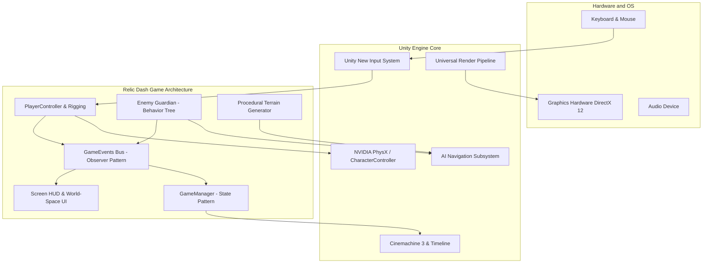
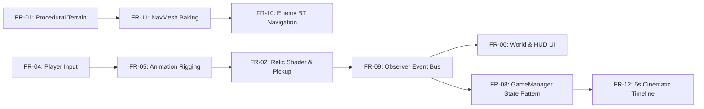
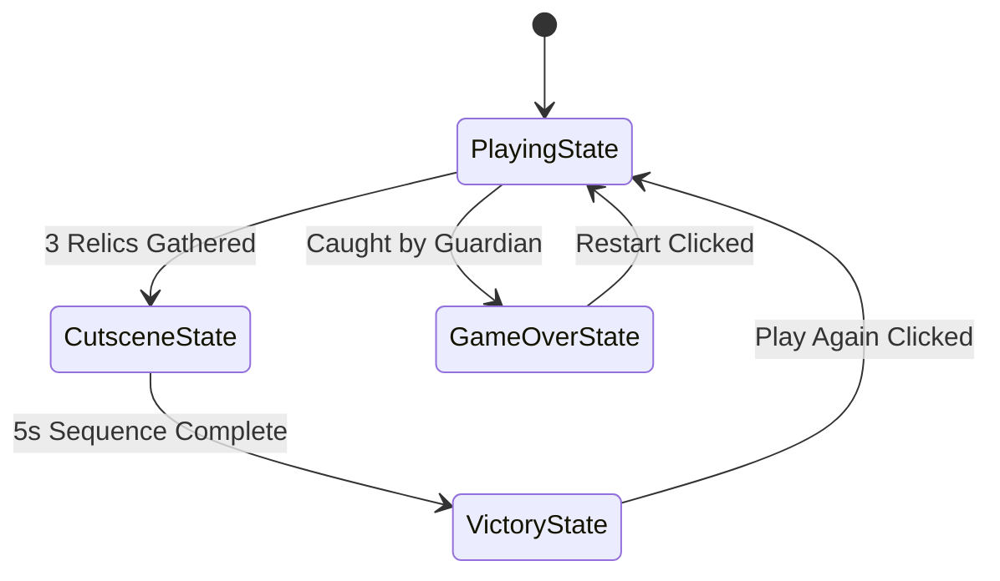
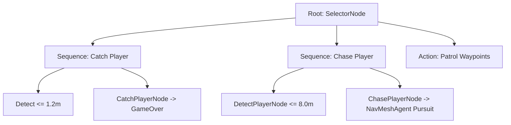

# SOFTWARE REQUIREMENTS SPECIFICATION (SRS)
## RELIC DASH: THE LOST ISLAND

---

**Project Title:** Relic Dash: The Lost Island  
**Author / Developer:** Basit (Basit0012)  
**Academic Module / Assessment:** CSE434 — Game Development in 3D Practical Examination (CA-2)  
**Engine & Render Pipeline:** Unity 6 (6000.3.10f1 LTS) — Universal Render Pipeline (URP)  
**Version:** 1.0.0  
**Repository:** [https://github.com/Basit0012/Game-Navmesh](https://github.com/Basit0012/Game-Navmesh)  
**Document Standard:** IEEE Std 830-1998 / ISO/IEC/IEEE 29148  

---

## 1. Introduction

### 1.1 Purpose
This Software Requirements Specification (SRS) document details the complete functional, non-functional, behavioral, architectural, and environmental specifications for the 3D game **"Relic Dash: The Lost Island"**. It serves as the formal technical specification for academic evaluation, code audit, and examination verification under CSE434 Game Development in 3D.

### 1.2 Scope
**Relic Dash: The Lost Island** is a 3D third-person action-adventure exploration and navigation game set on a procedurally generated floating island. The player navigates an agile avatar across variable terrain, discovers three mystical energy relics pulsing with custom emission shaders, solves spatial navigation challenges around ancient ruins, and evades an autonomous guardian powered by a modular Behavior Tree. Upon collecting all relics, an automated cinematic Timeline sequence unseals the ancient exit portal and transitions the system into victory evaluation.

The system is implemented purely in C# on Unity 6 with the Universal Render Pipeline (URP), utilizing modern architecture including the State Design Pattern, the Observer Pattern, Unity AI Navigation (NavMesh), Cinemachine 3, Animation Rigging, and Unity's New Input System.

### 1.3 Definitions, Acronyms, and Abbreviations
* **SRS:** Software Requirements Specification
* **URP:** Universal Render Pipeline (Unity's scriptable, high-performance rendering architecture)
* **NavMesh:** Navigation Mesh (Spatial surface representation used for AI pathfinding)
* **BT:** Behavior Tree (Hierarchical decision-making model composed of Composite and Action nodes)
* **FSM:** Finite State Machine (Behavioral design pattern managing game execution states)
* **SO:** ScriptableObject (Unity data container for decoupled configuration)
* **HUD:** Heads-Up Display (Overlay graphical user interface)
* **TMP:** TextMesh Pro (Advanced text rendering system using Signed Distance Field)
* **CC0:** Creative Commons Zero (Public domain asset dedication)

### 1.4 References
1. IEEE Std 830-1998: *IEEE Recommended Practice for Software Requirements Specifications*.
2. Unity 6 Documentation: *Universal Render Pipeline, AI Navigation, Cinemachine, Animation Rigging, and Input System*.
3. CSE434: *Game Development in 3D Course Syllabus and Assessment Criteria*.
4. Gamma, E., Helm, R., Johnson, R., & Vlissides, J. (1994): *Design Patterns: Elements of Reusable Object-Oriented Software*.

---

## 2. Overall Description

### 2.1 Product Perspective
**Relic Dash** is a standalone, real-time 3D simulation executable. It interfaces directly with GPU graphics APIs (DirectX 12 / Vulkan) via URP, queries human input devices via Unity's New Input System (`com.unity.inputsystem`), and drives agent traversal through the Unity AI Navigation subsystem (`com.unity.ai.navigation`).

### 2.2 Product Functions (High-Level)
* **Topography Generation:** Dynamically generates multi-octave Perlin noise floating island terrain with realistic radial cliff falloff at runtime.
* **Player Locomotion:** Responsive third-person camera-relative movement, directional sprinting, physics-based jumping, and ground adherence.
* **Procedural Inverse Kinematics:** Dynamically aims the player's head/visor towards the nearest active relic using Animation Rigging Multi-Aim constraints.
* **Intelligent Adversary:** Autonomous guardian utilizing a modular Behavior Tree that alternates between waypoint patrol, player detection (8m radius), persistent chasing, and catch triggers.
* **Collectibles & Feedback:** 3 ancient relics featuring sine-pulsing emission shaders, spark particles, bobbing/spinning levitation, and spatial audio feedback.
* **Decoupled Architecture:** Event-driven communication bus (Observer Pattern) ensuring zero tight coupling between game logic, UI, and cutscenes.
* **Cinematic Victory:** 5-second fixed-length Timeline sequence coordinating Cinemachine virtual camera blend, physical gate unsealing, and portal ignition.

### 2.3 User Classes and Characteristics
* **Player / Evaluator:** End-user exploring the game using standard keyboard and mouse inputs.
* **Academic Examiner:** Evaluator testing compliance of all 12 syllabus requirements using built-in automation verification menus (`RelicDash > Verify All Examination Requirements`).

### 2.4 Operating Environment
* **Platform:** Windows 10 / 11 (64-bit).
* **Game Engine:** Unity 6 (6000.3.10f1 LTS).
* **Render Pipeline:** Universal Render Pipeline (URP) Asset Profile.
* **Target Frame Rate:** Minimum 60 FPS at 1080p resolution.
* **Input Devices:** Standard PC Keyboard and 2-button Mouse with scroll wheel.

### 2.5 Design and Implementation Constraints
1. **Module Compliance:** Must strictly implement all 12 syllabus technical requirements without third-party proprietary dependencies.
2. **Package Ecosystem:** Constrained to official Unity Registry packages:
   * `com.unity.inputsystem` (v1.13.1+)
   * `com.unity.ai.navigation` (v2.0.7+)
   * `com.unity.cinemachine` (v3.1.3+)
   * `com.unity.animation.rigging` (v1.3.1+)
   * `com.unity.render-pipelines.universal` (v17.0.3+)
   * `com.unity.textmeshpro` (v3.2.0+)
3. **Licensing:** All downloaded 3D nature props, ruin structures, and audio files must adhere to CC0 (Public Domain) licensing.

---

## 3. System Features & Functional Requirements

### FR-01: Procedural Terrain Generation
* **Description:** The system shall synthesize a continuous 3D island terrain dynamically using mathematical noise functions.
* **Inputs:** Seed integer, primary frequency scale (`0.035`), secondary ridge scale (`0.085`), maximum height (`12.0m`), radial falloff exponent (`2.4`).
* **Processing:** Computes composite octave noise `Mathf.PerlinNoise` modulated by distance from the island center to enforce sheer oceanic cliff borders and a flattened center plateau.
* **Output:** Modifies the runtime `TerrainData.SetHeights()` heightmap and assigns multi-layer slope-blended texturing (grass plateaus and rock cliffs).

### FR-02: Relic Pulsing Shader & Collectibles
* **Description:** Exactly three mystical relics shall be distributed across the island, featuring dynamic visual and audio feedback.
* **Processing:**
  * Runs custom shader / material property block modulating emission color harmonically:  
    $$I(t) = \text{Lerp}(I_{min}, I_{max}, \text{PingPong}(t \times \text{speed}, 1.0))$$
  * Emits continuous ambient cyan spark particles and spatial point light glow.
  * Detects trigger overlap with the player avatar, triggers instant particle burst, plays `relic_pickup.ogg`, and dispatches the pickup event to `GameEvents`.

### FR-03: Cinemachine Virtual Camera Tracking
* **Description:** Third-person camera tracking implemented via Cinemachine 3.
* **Processing:**
  * Main Camera carries a `CinemachineBrain`.
  * Virtual camera `CM_PlayerCamera` tracks the Player transform using `CinemachineFollow` with offset `(0, 2.6, -5.5)` and damping `(0.1, 0.1, 0.1)`.
  * `CinemachineRotationComposer` softly composes framing at player eye level `(0, 1.4, 0)`.

### FR-04: Player Locomotion & New Input System
* **Description:** Player movement driven by `PlayerInput` and `CharacterController`.
* **Actions:**
  * `Move` (Vector2): Camera-relative horizontal translation.
  * `Sprint` (Button): Accelerates movement speed from `6.0 m/s` to `9.5 m/s`.
  * `Jump` (Button): Imparts vertical velocity:  
    $$v_y = \sqrt{2 \times g \times h}$$
* **Audio Feedback:** Loops footstep audio (`player_footstep.ogg`) while grounded and moving; triggers jump and landing audio clips.

### FR-05: Animation Rigging & Procedural Look-At
* **Description:** Real-time head aim IK directed towards the nearest active relic.
* **Processing:**
  * Utilizes `RigBuilder` and `MultiAimConstraint` targeted to the avatar's head/visor bone.
  * `RelicLookAtTarget.cs` calculates distances to all remaining relics in `RelicItem.ActiveRelics`:
    * If closest relic is within range ($d \le 16.0\text{m}$), interpolates aim weight to `1.0` and aims toward the relic.
    * If no relic is in range, eases weight back to `0.0`.

### FR-06: World-Space & Screen-Space User Interface
* **Description:** Dual-tier user interface conveying gameplay progress.
* **World-Space UI:**
  * Canvas attached directly above the player avatar with `Billboard.cs` ensuring continuous camera-facing alignment.
  * Displays dynamic count `RELICS: X / 3` with scale punch spring-animation feedback upon collection.
* **Screen-Space HUD:**
  * Fixed overlay presenting global objective guidance, game status, Game Over panel, and Victory statistics.

### FR-07: ScriptableObject Configuration Architecture
* **Description:** Centralized ScriptableObject asset `GameSettings.asset` defining balance variables without script recompilation.
* **Configured Fields:**
  * `MoveSpeed` (6.0), `SprintSpeed` (9.5), `JumpForce` (6.5), `GravityModifier` (18.0)
  * `TargetRelicCount` (3)
  * `GuardianDetectionRadius` (8.0m), `GuardianPatrolSpeed` (3.2m/s), `GuardianChaseSpeed` (5.5m/s)

### FR-08: GameManager & State Design Pattern
* **Description:** Singleton architecture orchestrating complete game lifecycle via clean state transitions:

* **States:**
  1. `PlayingState`: Standard player exploration and adversary behavior active.
  2. `CutsceneState`: Player input locked, cinematic letterbox active, Timeline playing.
  3. `GameOverState`: Input locked, red vignette, Game Over menu displayed.
  4. `VictoryState`: Victory screen displayed showing total elapsed time.

### FR-09: Observer Pattern Event Bus
* **Description:** Static multicast C# delegate bus `GameEvents.cs` decoupling broadcasters and listeners:
  * `OnRelicCollected(GameObject relic)`
  * `OnRelicCountChanged(int current, int total)`
  * `OnAllRelicsCollected()`
  * `OnPlayerCaught()`
  * `OnGameStateChanged(GameState newState)`
  * `OnRestartRequested()`

### FR-10: Enemy AI & Modular Behavior Tree
* **Description:** Autonomous Guardian adversary executing a modular Behavior Tree:

* **Behavior Tree Composition:**
  * **Composite Nodes:** `SelectorNode` (fallback), `SequenceNode` (AND logic).
  * **Leaf Nodes:**
    * `DetectPlayerNode`: Evaluates Euclidean distance to player against 8.0m threshold. Shifts visor light color to hostile red upon acquisition.
    * `ChasePlayerNode`: Sets `NavMeshAgent.destination` to player transform at chase speed.
    * `CatchPlayerNode`: Dispatches `OnPlayerCaught` when distance $\le 1.2\text{m}$.
    * `PatrolNode`: Cycles cyclically through designated island waypoints.

### FR-11: NavMesh & Dynamic Obstacle Carving
* **Description:** AI navigation surface baked over procedural island geometry with obstacle carving.
* **Processing:**
  * `NavMeshSurface` builds navigation mesh dynamically over irregular procedural terrain heights.
  * Ancient ruins and monoliths carry `NavMeshObstacle` components with `carving = true`, dynamically carving holes in the NavMesh to prevent AI clipping.

### FR-12: Cinematic Victory Timeline
* **Description:** 5.0-second fixed-duration Unity Timeline (`VictoryTimeline.playable`) triggered when 3 relics are collected.
* **Cinematics:**
  * Track 1 (`CinemachineTrack`): Blends from player view to northern portal gate camera (`CM_GateCamera`).
  * Exit Gate script slides open stone doors (`Door_Left`, `Door_Right`) and activates swirling cyan portal vortex.
  * Transitions cleanly into `VictoryState` upon completion.

---

## 4. External Interface Requirements

### 4.1 User Interfaces
* **In-Game HUD:** Minimalist top banner displaying relic counter and context objective string.
* **World Canvas:** Billboarded floating counter above player head.
* **Cinematic Bars:** Dual 80px black letterbox overlays during Cutscene state.
* **Menus:** Modal Game Over and Victory popups with Restart and Quit buttons.

### 4.2 Hardware Interfaces
* Standard PC Keyboard (W/A/S/D, Space, Shift).
* Standard PC Mouse (Mouse delta rotation, Left Click).
* Audio Output Interface (Stereo 44.1/48 kHz).

### 4.3 Software Interfaces
* **Unity 6 LTS Runtime Environment:** Core engine handling rendering, serialization, and physics.
* **Graphics API:** DirectX 12 / Vulkan via Universal Render Pipeline shader graph and lit passes.

---

## 5. Non-Functional Requirements (NFR)

### 5.1 Performance Requirements
* **Frame Rate:** Sustained $\ge 60$ frames per second on mid-range gaming hardware (GTX 1650 or higher).
* **Draw Calls & Batching:** Static geometry and procedural props combined to maintain $< 250$ draw calls.
* **Memory Footprint:** Total runtime heap and native memory footprint $< 1.5\text{ GB}$.

### 5.2 Reliability & Fault Tolerance
* Dynamic null-conditional checks on all external camera, player, and audio references.
* Graceful fallback in Behavior Tree nodes if targets are temporarily invalidated.
* Re-baking guard ensuring NavMesh surfaces never instantiate invalid agent paths.

### 5.3 Usability & Audio-Visual Polish
* Cohesive low-poly stylized fantasy aesthetic.
* Immediate acoustic confirmation on every interaction (footsteps, jumps, pickups, button clicks).
* High-contrast HUD elements utilizing TextMesh Pro SDF font rendering.

---

## 6. Verification & Traceability Matrix

| Req ID | Requirement Description | Implementation Files | Status |
|---|---|---|:---:|
| **FR-01** | Procedural Perlin Terrain & Island Falloff | `ProceduralTerrainGenerator.cs` | **VERIFIED** |
| **FR-02** | Relic Pulsing Emission Shader & Collectibles | `RelicItem.cs`, `RelicPulsingShader.shader` | **VERIFIED** |
| **FR-03** | Cinemachine 3 Camera Following & Damping | `CM_PlayerCamera`, `CinemachineBrain` | **VERIFIED** |
| **FR-04** | Third-Person Controller (New Input System) | `PlayerController.cs`, `InputSystem_Actions` | **VERIFIED** |
| **FR-05** | Animation Rigging Multi-Aim Relic Tracking | `RelicLookAtTarget.cs`, `MultiAimConstraint` | **VERIFIED** |
| **FR-06** | World-Space Relic Counter with Billboard | `PlayerWorldUI.cs`, `Billboard.cs` | **VERIFIED** |
| **FR-07** | ScriptableObject Parameter Configuration | `GameSettings.cs`, `GameSettings.asset` | **VERIFIED** |
| **FR-08** | GameManager Finite State Machine | `GameManager.cs`, `IGameState.cs` | **VERIFIED** |
| **FR-09** | Decoupled Observer Event Bus | `GameEvents.cs` | **VERIFIED** |
| **FR-10** | Modular Behavior Tree Enemy Guardian AI | `EnemyBTController.cs`, `BehaviorTree/*.cs` | **VERIFIED** |
| **FR-11** | NavMeshSurface & Dynamic Carving Obstacles | `NavMeshSurface`, `NavMeshObstacle` | **VERIFIED** |
| **FR-12** | 5-Second Cinematic Victory Timeline | `VictoryTimeline.playable`, `ExitGate.cs` | **VERIFIED** |

---

*Document approved for submission — CSE434 Game Development in 3D Practical Examination.*
